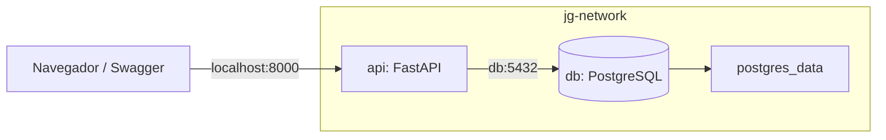

# JG Repuestos

JG Repuestos es mi proyecto de gestión comercial e inventario de repuestos
automotrices. Para la entrega del proyecto 1, Escenario 3, configuré dos
contenedores: una API con FastAPI y una base de datos PostgreSQL.

La comunicación entre ambos se realiza por el nombre del servicio `db`, dentro
de la red de Docker. El frontend está desarrollado en React y TypeScript y se
ejecuta por separado.

Repositorio: https://github.com/JesusGalvis05/Repuestos_SAS

## Cómo levantar los contenedores

### 1. Requisitos

- Git para descargar el proyecto.
- Docker Desktop iniciado con el motor de contenedores Linux y Docker Compose.
- Python 3.12 o superior para generar la configuración local.
- Puerto 8000 disponible.

### 2. Descargar el proyecto

```bash
git clone https://github.com/JesusGalvis05/Repuestos_SAS.git
cd Repuestos_SAS
```

Los siguientes comandos se ejecutan desde la raíz del proyecto, donde está el
archivo `docker-compose.yml`.

### 3. Crear la configuración y levantar los servicios

```bash
python scripts/configure.py
docker compose config --quiet
docker compose up --build -d --wait
docker compose ps
```

El primer comando genera el archivo `.env` con las variables y contraseñas
necesarias. Si el archivo ya existe, conserva sus valores y completa los que
falten. Dejé `.env.example` como referencia; `.env` está incluido en `.gitignore`.

`docker compose up --build -d --wait` construye la imagen de la API, descarga
PostgreSQL y deja los dos servicios ejecutándose en segundo plano. El comando
espera hasta que ambos estén saludables. Las migraciones de Alembic se aplican
automáticamente antes de iniciar la API.

En la salida de `docker compose ps` deben aparecer `api` y `db` con estado
`healthy`.

### 4. Abrir la API

- Swagger, para consultar y probar los endpoints: http://localhost:8000/api/v1/docs
- Estado de la API: http://localhost:8000/api/v1/health
- Comprobación de conexión con la base de datos: http://localhost:8000/api/v1/ready

## Servicios y arquitectura

| Servicio | Función | Puerto | Datos persistentes |
| --- | --- | --- | --- |
| `api` | Backend FastAPI con SQLAlchemy, Pydantic y Alembic | `localhost:8000` | Los guarda en PostgreSQL |
| `db` | Base de datos PostgreSQL | `5432` dentro de Docker | Volumen `postgres_data` |

Los dos servicios pertenecen a la red `jg-network`. La API se conecta a
`db:5432` usando las variables del `.env`. PostgreSQL queda accesible desde esa
red, sin publicar su puerto en el equipo.



La imagen de la API se define en [backend/Dockerfile](backend/Dockerfile), con
Python `3.12.16-slim-bookworm` y un usuario sin privilegios de administrador.
La base de datos usa la imagen oficial `postgres:17.11-bookworm`.

## Comprobar la comunicación entre contenedores

Con los servicios activos, ejecuto esta prueba desde la raíz del proyecto:

```bash
docker compose exec -T api python -m app.diagnostics roundtrip
```

La prueba crea un usuario temporal inactivo, guarda el registro en PostgreSQL,
lo consulta en una transacción nueva y después elimina únicamente ese registro.
La salida debe mostrar `status: passed`, `host: db`, `server_port: 5432` y
`cleanup: passed`.

Esta es la operación de escritura y lectura que uso para demostrar que la API
se comunica con PostgreSQL por el nombre del servicio.

## Consultar contenedores, red y registros

```bash
docker compose ps
docker ps
docker network inspect jg-network
docker compose logs api
docker compose logs db
```

Para construir la imagen de la aplicación de forma independiente:

```bash
docker build --target runtime -t jg-repuestos-api:academic backend
```

## Detener y volver a iniciar

Para detener y retirar los contenedores:

```bash
docker compose down
```

El volumen de PostgreSQL se conserva, por lo que los datos siguen disponibles
al volver a iniciar:

```bash
docker compose up -d --wait
```

## Crear el primer administrador

Para usar las funciones protegidas de usuarios y autenticación:

```bash
docker compose exec api python -m app.cli create-admin
```

El comando pide correo, nombre y contraseña. La contraseña debe tener al menos
12 caracteres. El proyecto no incluye una cuenta predeterminada. Después del
alta, las demás cuentas se gestionan desde la aplicación o la API autorizada.

## Pruebas automáticas

Para ejecutar Pytest dentro de `api`, uso la etapa de pruebas del Dockerfile:

```bash
docker build --target test -t jg-repuestos-api:academic backend
docker compose up -d --no-build --force-recreate --wait api
docker compose exec -T -e RUN_DOCKER_COMMUNICATION=1 api python -m pytest -q -p no:cacheprovider
```

La suite validada tiene **32 pruebas aprobadas**, incluyendo autenticación,
permisos, migraciones y comunicación con PostgreSQL. Al finalizar, recupero la
imagen normal de ejecución:

```bash
docker compose build
docker compose up -d --force-recreate --wait api
```

## GitHub Actions

El pipeline está en [.github/workflows/docker-ci.yml](.github/workflows/docker-ci.yml)
y se ejecuta con cada push o pull request. Construye la imagen, levanta los dos
servicios, comprueba la comunicación y persistencia, ejecuta las pruebas y apaga
los contenedores. También prueba y compila el frontend.

[Ejecución aprobada de GitHub Actions](https://github.com/JesusGalvis05/Repuestos_SAS/actions/runs/42732380556).

## Organización del proyecto

```text
backend/          API, Dockerfile, migraciones y pruebas
frontend/         Interfaz React y TypeScript
scripts/          Configuración y validación del proyecto
docs/             Documentación técnica y académica
.github/workflows/ Pipeline de GitHub Actions
docker-compose.yml Definición de api, db, red y volumen
.env.example      Plantilla de variables de entorno
```

El frontend se inicia con Vite fuera de Compose. Las instrucciones para trabajar
con React, depurar con Visual Studio Code o ejecutar el proyecto sin Docker están
en el [manual técnico](docs/manual-tecnico.md) y la
[guía de despliegue](docs/despliegue.md).

## Documento y evidencias de la entrega

- [Informe en PDF](docs/entrega-1/JG_Repuestos_Entrega_1_Escenario_3.pdf).
- [Prueba de comunicación y persistencia en Docker](docs/entrega-1/evidencias/ejecuciones/20261109-193746/resultado.json).
- [Artefactos de GitHub Actions](docs/entrega-1/evidencias/github-actions/42731671529/).
- [Guion de demostración](docs/entrega-1/demostracion.md).
- [Capturas y lista de evidencias pendientes](docs/entrega-1/capturas/README.md).

Las evidencias incluyen resultados de ejecuciones reales y salidas con los
secretos ocultos. Las claves privadas, contraseñas y datos locales están
excluidos mediante `.gitignore` y `.dockerignore`.
