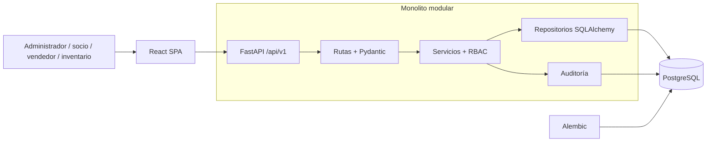

# Arquitectura de JG Repuestos

Estado: implementación incremental; esta entrega abarca exclusivamente la Fase 1.

La entrega académica Docker utiliza exactamente dos servicios de ejecución, api
y db, en `docker-compose.yml`. El frontend permanece en su carpeta y se ejecuta
fuera de Compose. El arranque api aplica Alembic dentro del mismo contenedor.

Una aplicación FastAPI desplegable contiene módulos de negocio. PostgreSQL es la
única base de datos operacional. React consume contratos REST bajo `/api/v1`.
SQLAlchemy 2.0 mantiene los modelos; Pydantic v2 define contratos independientes;
Alembic es el único mecanismo de evolución del esquema. Pytest sustituye JUnit.
No existen microservicios ni aplicaciones backend independientes.

```text
backend/
  app/
    core/                 configuración, seguridad, errores, base de datos
    modules/
      identity/           rutas, esquemas, modelos, servicios, repositorios
      audit/              modelos y repositorio de auditoría
    main.py               única aplicación ASGI
    cli.py                aprovisionamiento administrativo seguro
  migrations/             revisiones Alembic versionadas
  tests/                  pruebas de reglas, HTTP y PostgreSQL
frontend/src/             aplicación React + TypeScript + Vite + Tailwind
docs/                     requisitos, diagramas, decisiones y manuales
scripts/                  ejecución y verificación local
.vscode/                  depuración y tareas
```

Cada módulo futuro (catálogo, proveedores, inventario, compras, ventas, finanzas)
seguirá la separación `routes.py`, `schemas.py`, `models.py`, `services.py`,
`repository.py`. No se crean módulos vacíos ni endpoints simulados.

Una sesión SQLAlchemy por solicitud y una transacción por caso de uso HTTP;
la dependencia con alcance `function` confirma antes de enviar la respuesta y
revierte ante errores. Los repositorios consultan y hacen `flush`, nunca `commit`.
Las operaciones administrativas usan bloqueos PostgreSQL para serializar cambios
de privilegios y conservar al menos un administrador activo. La renovación bloquea
la sesión antes de rotar sus credenciales. Los fallos de autenticación se devuelven
como resultados explícitos para confirmar contadores y revocaciones.

## Contrato para fases transaccionales posteriores

Compras, ventas y movimientos compartirán esta misma sesión; nunca confirmarán
parcialmente documentos, movimientos y saldos. Bloquearán saldos con
`SELECT ... FOR UPDATE` en orden estable producto/bodega. Al crear un saldo se
usará `INSERT ... ON CONFLICT`, seguido del bloqueo. Restricciones impedirán
cantidades negativas. Un registro de idempotencia tendrá clave única por actor,
operación y clave suministrada, hash canónico de la petición y respuesta persistida
en la misma transacción. Repetir una clave con contenido distinto devolverá 409.
Una reversión revertirá también la clave. Los movimientos serán inmutables y las
correcciones compensatorias. Esto es diseño de fases 4–5, aún no funcionalidad.

Dinero: `decimal.Decimal`, contratos decimales y `NUMERIC` PostgreSQL; nunca
`float`. Se conserva costo promedio ponderado móvil, distinguiendo margen y
recargo. Instantes UTC con zona horaria; presentación `America/Bogota`, COP.



Referencias: [transacciones SQLAlchemy](https://docs.sqlalchemy.org/en/20/orm/session_basics.html),
[dependencias FastAPI](https://fastapi.tiangolo.com/tutorial/dependencies/dependencies-with-yield/).
