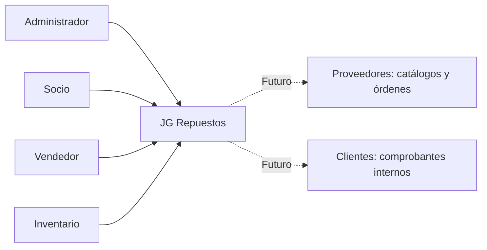
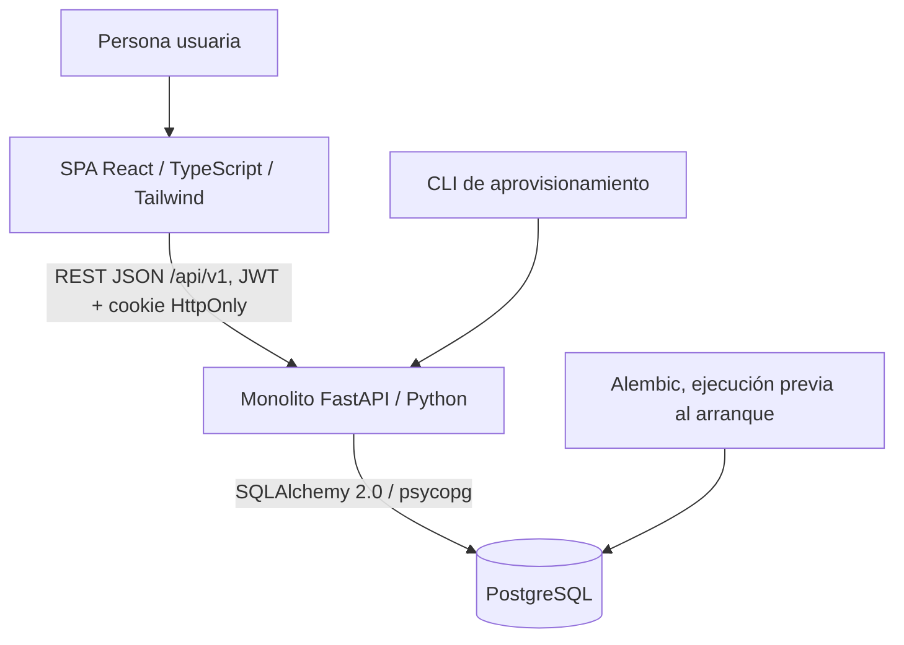
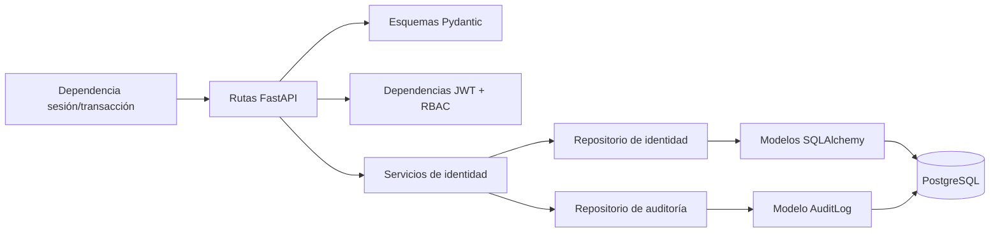
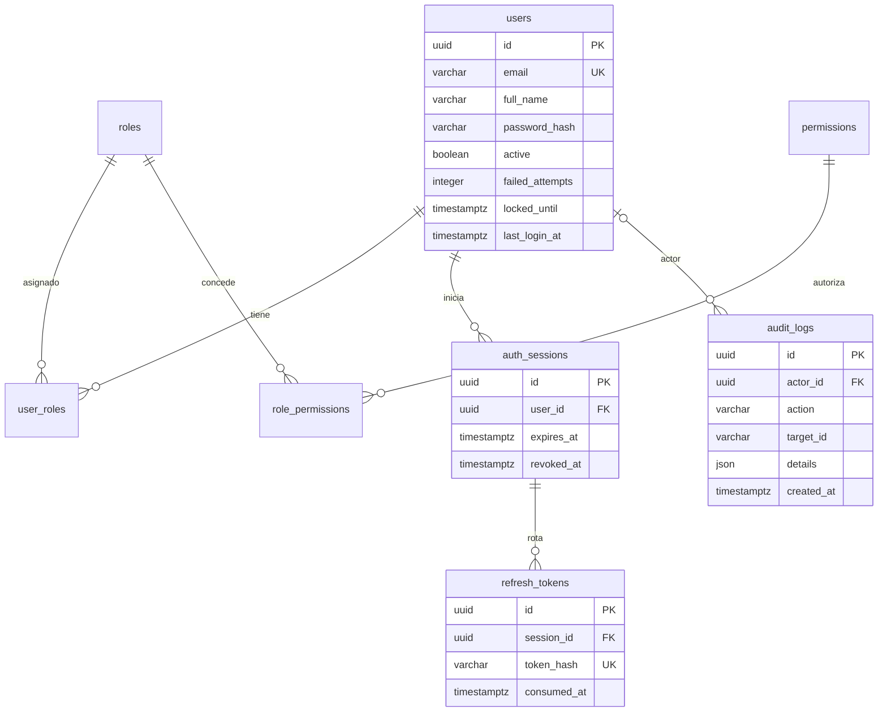
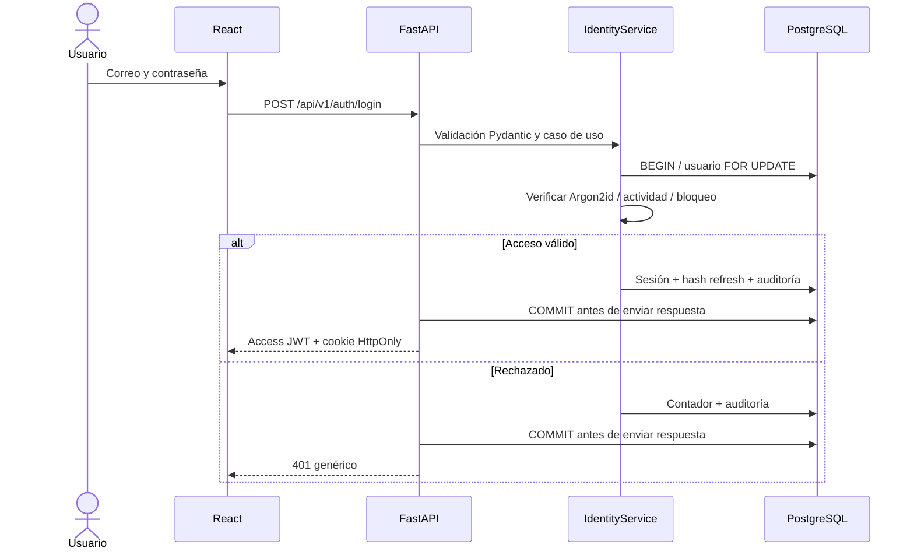
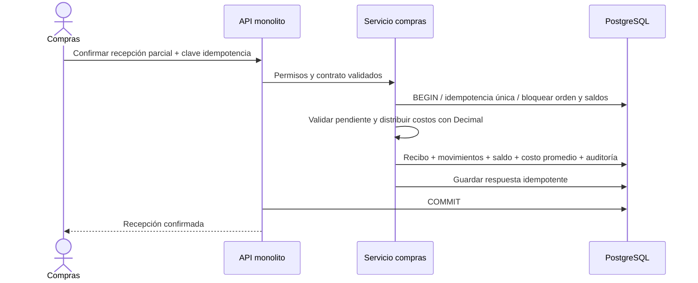
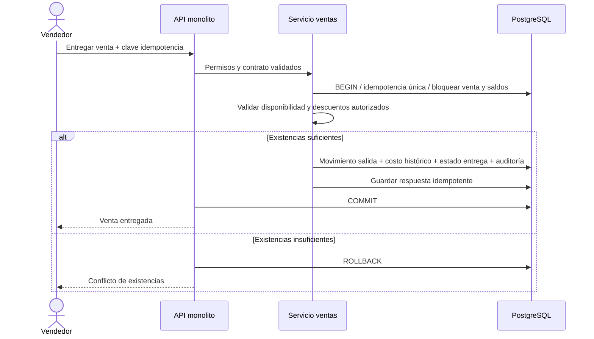

# Diagramas mantenibles

## C4 — contexto

## C4 — contenedores

La CLI reutiliza servicios del monolito, no es otra aplicación backend desplegable.
En el Compose académico sólo existen api y db; React se ejecuta con Vite en el
host y dirige `/api` a FastAPI. El despliegue local alternativo sirve el build
React desde el mismo proceso FastAPI. No se incluye nginx como tercer servicio.

## Componentes implementados

## Entidad-relación — esquema existente

Las entidades comerciales del documento maestro se agregarán con migraciones
de las fases correspondientes; este diagrama no afirma que existan todavía.

## Secuencia implementada — autenticación

## Diseño futuro — compra y recepción (Fase 4)

## Diseño futuro — venta entregada (Fase 5)

