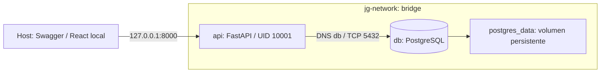

# JG Repuestos — Entrega proyecto 1, Escenario 3

## Portada

Proyecto: Sistema web de gestión comercial e inventario JG Repuestos.

Actividad: Contenedores Docker, Docker Compose y GitHub Actions.

Estudiante, institución, asignatura y docente: completar con los datos reales antes de entregar.

Fecha de preparación: 8 de noviembre de 2026. Actualización y validación Docker:
9 de noviembre de 2026. Zona horaria: America/Bogota.

Fecha límite: martes 10 de noviembre de 2026 a las 23:55.

Repositorio GitHub: pendiente de publicar y registrar la URL real. No existe remoto configurado en esta revisión.

Estado: construcción, salud, migraciones, comunicación, persistencia y Pytest
aprobados en Docker local. Publicación y ejecución remota de GitHub pendientes.

## 1. Introducción

JG Repuestos es un proyecto de gestión comercial para un negocio colombiano de
repuestos automotrices. Su implementación incremental comienza con autenticación,
usuarios, permisos y sesiones. La actividad académica adapta esa base a dos
contenedores comunicados y a un flujo de integración continua reproducible.

Esta entrega se limita a DevOps y a la Fase 1 existente. No incorpora productos,
compras ni otras funciones de la Fase 2. Distingue expresamente las verificaciones
realizadas de las que requieren infraestructura todavía no disponible.

## 2. Objetivo general

Preparar y verificar una solución de dos servicios Docker para FastAPI y
PostgreSQL, con comunicación mediante DNS interno, persistencia, configuración
segura y un pipeline automatizado que genere evidencias reales.

## 3. Descripción de la aplicación

El backend utiliza Python, FastAPI, SQLAlchemy 2.0, Pydantic v2 y Alembic; la
aplicación mantiene un monolito modular y una única aplicación ASGI desplegable.
El frontend React y TypeScript permanece en su carpeta y se ejecuta desde el host
durante esta demostración. El Compose académico no contiene un servicio frontend.

La API ofrece autenticación, control de sesiones, autorización RBAC y gestión de
usuarios. Las contraseñas se almacenan con Argon2id. Los endpoints de gestión
exigen autorización; la actividad no añade rutas públicas de escritura.

## 4. Arquitectura y red Docker



Existen exactamente dos servicios de ejecución: api y db. La red bridge tiene
el nombre explícito jg-network. Sólo api publica el puerto 8000, ligado a la
interfaz de bucle local. PostgreSQL no publica puertos al host; su 5432 es interno.
El volumen postgres_data conserva el directorio de datos cuando se recrean los
contenedores sin eliminarlo.

La API recibe POSTGRES_HOST=db y POSTGRES_PORT=5432. Construye una URL con
SQLAlchemy.URL.create usando usuario, contraseña y nombre de base provenientes
del entorno. Esto codifica correctamente caracteres especiales. DOCKER_RUNTIME
impide arrancar con localhost, IPs fijas u otro puerto como destino de PostgreSQL.

## 5. Contenedor de aplicación

backend/Dockerfile utiliza la imagen oficial python:3.12.16-slim-bookworm. Copia
primero requirements.lock para aprovechar la caché de dependencias; instala con
pip sin caché y después copia el código y las migraciones. La etapa final runtime
no contiene Pytest ni las pruebas; la etapa opcional test agrega esas herramientas.

El proceso se ejecuta con UID y GID 10001, sin privilegios de root, y expone 8000.
Su comando python -m app.deploy ejecuta Alembic upgrade head antes de iniciar
Uvicorn. Un fallo de migración impide servir la API. No se usa create_all para
evolucionar el esquema ni se crea un tercer servicio permanente.

La imagen de PostgreSQL es postgres:17.11-bookworm. Ambas etiquetas se contrastaron
con los manifiestos de Docker Official Images. El 9 de noviembre se descargó
PostgreSQL y se construyeron las imágenes de ejecución y pruebas con éxito. El
log de construcción conserva el identificador SHA-256 real de la imagen obtenida.

## 6. Docker Compose

El archivo canónico es docker-compose.yml. Se retiró la configuración anterior
de cuatro servicios para evitar que Compose seleccione accidentalmente otro
archivo. api depende de db mediante condition: service_healthy. PostgreSQL usa
pg_isready con el usuario y la base configurados; api consulta su endpoint ready.

Ambos servicios usan restart: unless-stopped. api restringe privilegios nuevos y
elimina capacidades Linux adicionales. Los secretos se generan en .env y no se
incluyen en las imágenes ni se versionan. .env.example contiene campos vacíos de
secreto; scripts/configure.py genera valores aleatorios sin imprimirlos.

Estos comandos forman parte de la validación reproducible:

```text
docker compose config
docker compose build
docker compose up -d
docker compose ps
docker ps
docker network inspect jg-network
docker compose logs api
docker compose logs db
```

El recolector invoca config en formato JSON y guarda una versión saneada. Un
config manual imprime secretos interpolados y no debe capturarse sin ocultarlos.
Los comandos up del recolector añaden --wait para comprobar salud.

## 7. Demostración de escritura y lectura

```text
docker compose exec -T api python -m app.diagnostics roundtrip
```

El diagnóstico usa exactamente la misma configuración y fábrica de sesiones que
la API. Inserta un usuario UUID inactivo, sin roles, con nombre y correo marcados
como demostración; su contraseña aleatoria se descarta. Confirma la transacción,
consulta el registro en una sesión nueva y valida id, correo, nombre y estado.
También consulta current_database e inet_server_port para identificar la conexión.

La limpieza elimina sólo el UUID creado y exige simultáneamente correo derivado,
nombre de demostración, estado inactivo y ausencia de roles. Una prueba comprueba
que no puede eliminar un administrador normal. No se vacían tablas ni se borran
datos operacionales. No se añade un endpoint público para esta prueba.

La demostración se ejecutó dentro de api contra PostgreSQL db. El JSON real
confirma host db, puerto configurado 5432, puerto consultado al servidor 5432 y
cleanup=passed. También se aprobaron las pruebas de integración dentro de api.

## 8. Prueba de persistencia

scripts/docker_evidence.py crea otro registro marcado, conserva su UUID, ejecuta
docker compose down sin -v, vuelve a levantar ambos contenedores, lee el mismo
UUID y elimina únicamente ese registro. El volumen persiste entre ambos arranques.
Si la limpieza falla, el informe guarda pending_demo_id para una recuperación
limitada a ese registro. La secuencia se ejecutó con éxito: se recuperó el UUID
d9773fcd-b92d-4d3d-8e7d-2cae4e7ccb34 después de recrear ambos contenedores y se
eliminó únicamente ese registro de demostración. Los logs originales conservan
creación, parada, arranque, lectura y limpieza.

## 9. Integración continua

.github/workflows/docker-ci.yml se activa por push y pull_request, con permisos
de lectura del repositorio. Obtiene el código, prepara Buildx y genera credenciales
efímeras enmascaradas. El recolector construye la imagen, descarga PostgreSQL,
valida Compose, levanta dos contenedores, espera salud y ejecuta comunicación y
persistencia. Pytest se ejecuta dentro de api usando la etapa de pruebas y la misma
base db; no se agrega un tercer servicio. Un job separado prueba y compila React.

Los artefactos contienen salidas saneadas y códigos de retorno. El apagado usa
if: always(). No se publican imágenes en registros externos. La configuración del
workflow existe; su ejecución aprobada en GitHub no está verificada porque no hay
remoto ni una cuenta GitHub habilitada en este entorno.

## 10. Resultados reales y límites

| Verificación | Resultado real |
| --- | --- |
| Revisión estática de archivos | 18 comprobaciones aprobadas; no sustituye Docker |
| Suite backend con PostgreSQL nativo | 31 aprobadas, 1 omitida exclusiva de Docker |
| Suite backend dentro de api contra db | 32 aprobadas, sin omisiones |
| Prueba temporal de escritura/lectura/limpieza | Aprobada dentro de Docker mediante db:5432 |
| Protección contra limpieza de usuarios normales | Aprobada también dentro de Docker |
| Compose oficial portátil 2.39.4 | SHA-256 contrastado y config validado con código 0 |
| Docker CLI y motor | Docker Engine 29.9.2; Compose 5.6.1; motor Linux disponible |
| Construcción y migraciones | Aprobadas; revisión 0001_identity y alembic check sin diferencias |
| Red y salud | api y db saludables en jg-network; sólo 127.0.0.1:8000 publicado |
| Persistencia | Mismo UUID recuperado tras down/up conservando el volumen |
| Usuario y restauración | UID 10001 comprobado; imagen runtime restaurada tras las pruebas |
| Repositorio remoto y pipeline aprobado | Pendientes de GitHub |

El aviso de deprecación httpx de Starlette no provocó fallos en Pytest. Los logs
de PostgreSQL nativo están en evidencias/pytest-local.txt. Las pruebas Docker,
logs de comandos y resultados del 9 de noviembre se conservan en
evidencias/ejecuciones/20261109-193746/. Los informes blocked del 8 de noviembre
se conservan como historial del entorno anterior, ya superado al instalar Docker.

Se descargó Compose standalone oficial únicamente en .local/tools, excluido del
repositorio. Se verificó su SHA-256 y se ejecutaron version, config --quiet y
config --format json con éxito. Las evidencias compose-validacion-real.json y
compose-config-real.json documentan la validación y ocultan secretos. Disponer
de este parser no instala ni sustituye Docker Engine.

## 11. Evidencias incorporadas y pendientes

El PDF incorpora extractos reales de build, compose up, docker ps, network inspect,
escritura/lectura, recreación con persistencia, migraciones y Pytest. Los archivos
completos saneados están incluidos en el repositorio. Se incorporan capturas
reales del navegador para ready y Swagger, con URL y fecha en capturas-http.json.
Siguen pendientes los PNG de consola, GitHub Actions remoto aprobado y repositorio publicado. La lista
precisa de archivos y comandos se conserva en capturas/README.md. No se han
generado imágenes que imiten una consola ni resultados de CI inexistentes.

Antes de entregar se deben completar los datos de portada y la URL real del
repositorio e incorporar las capturas y el pipeline remoto aprobado. La
demostración Docker ya está ejecutada y documentada. La matriz de ocho criterios
y sus 150 puntos está en rubrica.md.

## 12. Conclusiones

La configuración preparada reduce el entorno a dos servicios y establece un
contrato verificable de conexión db:5432, migraciones previas al servidor y datos
persistentes en un volumen. La demostración privada conserva la autenticación y
limita sus cambios a usuarios temporales inactivos.

Las pruebas Docker aportan evidencia real de la comunicación y limpieza segura,
además de persistencia tras recrear los contenedores. La validación técnica local
de Docker está aprobada. La aceptación del pipeline remoto y de la entrega
académica continúa pendiente del repositorio publicado, capturas y datos de portada.
No se avanza a la Fase 2 ni se atribuyen puntos de evaluación sin revisión docente.

## 13. Referencias — APA 7

Docker, Inc. (s. f.). Control startup and shutdown order in Compose. Docker Docs.
Recuperado el 8 de noviembre de 2026, de https://docs.docker.com/compose/how-tos/startup-order/

Docker, Inc. (s. f.). Docker Build GitHub Actions. Docker Docs. Recuperado el 8 de
noviembre de 2026, de https://docs.docker.com/build/ci/github-actions/

Docker Official Images. (s. f.). Python: Official image metadata [Código fuente].
GitHub. Recuperado el 8 de noviembre de 2026, de
https://github.com/docker-library/official-images/blob/master/library/python

Docker Official Images. (s. f.). PostgreSQL: Official image metadata [Código fuente].
GitHub. Recuperado el 8 de noviembre de 2026, de
https://github.com/docker-library/official-images/blob/master/library/postgres

SQLAlchemy. (s. f.). Session basics. SQLAlchemy 2.0 Documentation. Recuperado el 8
de noviembre de 2026, de https://docs.sqlalchemy.org/en/20/orm/session_basics.html
