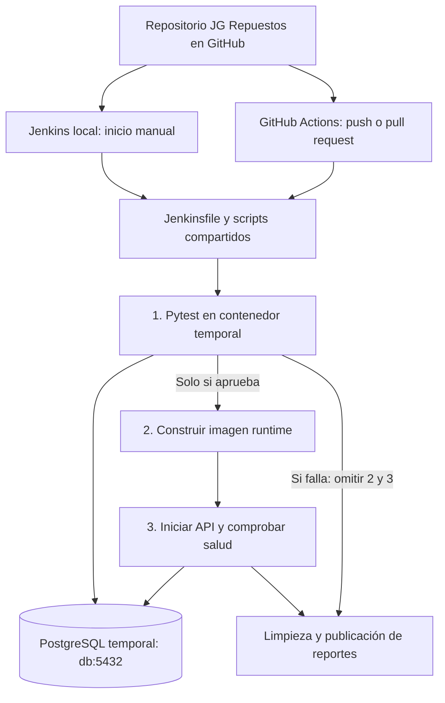

# JG Repuestos: integración continua con Jenkins

**Institución:** Politécnico Grancolombiano

**Asignatura:** Integración Continua

**Entrega:** Proyecto, Entrega 2 - Semana 5

**Estudiante:** [Completar nombre y código]

**Docente:** [Completar]

**Fecha de las verificaciones:** 22 de noviembre de 2026

**Repositorio:** https://github.com/JesusGalvis05/Repuestos_SAS

## Introducción

En la primera entrega configuré JG Repuestos con una API FastAPI y PostgreSQL,
contenedores Docker, Docker Compose y GitHub Actions. Para esta entrega agregué
Jenkins con configuración reproducible y reutilicé las pruebas existentes.
El propósito fue comprobar que una modificación pasa por pruebas automáticas
antes de construir y ejecutar la imagen final del backend.

## Objetivos

- Configurar Jenkins LTS con Java 21, Docker y Configuration as Code.
- Ejecutar pruebas, construcción y prueba de humo en etapas ordenadas.
- Aislar los datos de CI de la base de desarrollo.
- Demostrar que una prueba fallida bloquea las etapas posteriores.
- Comparar el proceso con GitHub Actions mediante resultados reales.

## Arquitectura y configuración

Jenkins se ejecuta en un Compose independiente con un volumen para conservar
usuarios, trabajos, plugins y resultados. Su interfaz se publica en el puerto
local 8081. El backend mantiene FastAPI, SQLAlchemy, Pydantic y Alembic.



Cada ejecución utiliza un proyecto `jg-ci-*`, una red independiente y PostgreSQL
en memoria temporal. Las pruebas se conectan por el nombre `db`, sin publicar el
puerto de la base de datos. El volumen de desarrollo permanece separado.

El Dockerfile existente permite construir un entorno `test` con Pytest y una
imagen `runtime` de aplicación. Construir el entorno de pruebas es parte de la
primera etapa; la imagen final se construye únicamente después de aprobarla.

## Seguridad y reproducibilidad

JCasC define la autenticación y crea el trabajo `JG-Repuestos`. Los plugins se
declaran con versiones en `jenkins/plugins.txt`. Las credenciales se suministran
mediante `jenkins/.env`, excluido de Git y del contexto de construcción. La
plantilla `.env.example` permite configurar otro equipo sin publicar secretos.

La comprobación HTTP confirmó que una petición anónima a la API de Jenkins recibe
403 y que CSRF está activo. Docker confirmó usuario `jenkins`, ausencia de modo
privilegiado, volumen persistente y publicación limitada a `127.0.0.1:8081`.

Para este laboratorio Jenkins monta el socket Docker. Ese acceso permite controlar
el motor y representa un riesgo si se ejecutan pipelines no confiables. Limité
el uso a código propio revisado y al equipo local. En un servidor compartido
serían necesarios agentes y motores aislados.

## Validación inicial

La ejecución [Jenkins 1](http://localhost:8081/job/JG-Repuestos/1/) obtuvo 32
pruebas aprobadas, sin fallos ni omisiones. La segunda etapa construyó la imagen
runtime; la tercera obtuvo respuestas correctas de `/api/v1/health` y
`/api/v1/ready` y completó una escritura y lectura real con limpieza en PostgreSQL.

En GitHub Actions, [CI - Entrega 2, ejecución 45105227996](https://github.com/JesusGalvis05/Repuestos_SAS/actions/runs/45105227996)
también aprobó con el commit `fd6806e`. El workflow de la primera entrega se
conservó y su [ejecución 45105228059](https://github.com/JesusGalvis05/Repuestos_SAS/actions/runs/45105228059)
terminó correctamente.

## Fallo controlado

Creé la rama `demo/entrega-2`. En el commit `1296bc1`, `prueba de error`, cambié
temporalmente de 600 a 601 segundos la expectativa de la prueba existente
`test_access_contract_and_wrong_key`. La funcionalidad siguió emitiendo tokens
con la duración configurada de 600 segundos, por lo que la aserción debía fallar.

La ejecución [Jenkins 2](http://localhost:8081/job/JG-Repuestos/2/) registró 31
pruebas aprobadas y una fallida. Su consola indicó explícitamente:

```text
Stage "Construccion de imagen" skipped due to earlier failure(s)
Stage "Prueba de humo" skipped due to earlier failure(s)
```

La API de Stage View etiqueta esas etapas como `FAILED`; para distinguir una
etapa omitida de un comando ejecutado revisé la consola y los artefactos. No se
generaron reportes de construcción runtime ni de humo para ese build.

En Actions, la [ejecución 45106218087](https://github.com/JesusGalvis05/Repuestos_SAS/actions/runs/45106218087)
falló en pruebas y marcó construcción y humo como `skipped`. La limpieza y la
publicación de reportes terminaron correctamente.

## Corrección

Después de autorizar el push, publiqué `22eba0b`, `correccion de prueba`, que
restaura exactamente la expectativa original de 600 segundos.
[Jenkins 3](http://localhost:8081/job/JG-Repuestos/3/) ejecutó las tres etapas
correctamente: 32 pruebas aprobadas, ninguna omitida, imagen construida y humo
satisfactorio. La [ejecución 45107537580 de Actions](https://github.com/JesusGalvis05/Repuestos_SAS/actions/runs/45107537580)
también aprobó las tres etapas para ese commit.

| Momento | Commit | Jenkins | GitHub Actions |
| --- | --- | --- | --- |
| Inicial | `fd6806e` | Build 1: aprobado | `45105227996`: aprobado |
| Error | `1296bc1` | Build 2: una prueba fallida; etapas posteriores omitidas | `45106218087`: fallido; construcción y humo omitidos |
| Corrección | `22eba0b` | Build 3: 32 pruebas y tres etapas aprobadas | `45107537580`: aprobado |

## Comparación

| Aspecto | Jenkins | GitHub Actions |
| --- | --- | --- |
| Archivo principal | `Jenkinsfile` | `.github/workflows/jenkins-parity.yml` |
| Servidor | Contenedor local administrado por mí | Runner hospedado administrado por GitHub |
| Ejecución de pruebas | Contenedores temporales en Docker Desktop | Contenedores temporales en Ubuntu |
| Inicio | Trabajo manual con parámetro de rama | Push o pull request |
| Reportes | Etapas, consola, JUnit XML de Pytest y artefactos | Pasos, registros y artefactos |

## Conclusiones basadas en las verificaciones

La ejecución inicial confirmó que el mismo código puede superar pruebas,
construcción y humo desde Jenkins y GitHub Actions. El fallo controlado mostró
que una aserción incorrecta detiene la construcción de la imagen final y la
prueba de humo en ambos sistemas. La limpieza se ejecutó también después del
fallo, y la aplicación de desarrollo siguió respondiendo correctamente.

Al restaurar la expectativa original, ambos sistemas volvieron a aprobar sin
desactivar validaciones ni cambiar la funcionalidad. La secuencia completa
quedó documentada con commits separados, reportes y capturas reales.

## Evidencias

Las imágenes y sus metadatos se encuentran en `capturas/`. Los resultados XML,
registros, identificadores de imagen y metadatos remotos están en `evidencias/`.
Las capturas de GitHub Actions se obtuvieron de la respuesta real de su API
oficial en Edge; no representan la interfaz gráfica de la pestaña Actions.

## Referencias

Docker. (s. f.). *Docker Engine security*. https://docs.docker.com/engine/security/

GitHub. (s. f.). *Events that trigger workflows*. https://docs.github.com/en/actions/reference/workflows-and-actions/events-that-trigger-workflows

Jenkins. (s. f.). *Configuration as Code*. https://plugins.jenkins.io/configuration-as-code/

Jenkins. (s. f.). *CSRF protection*. https://www.jenkins.io/doc/book/security/csrf-protection/

Jenkins. (s. f.). *Docker*. https://www.jenkins.io/doc/book/installing/docker/

Jenkins. (s. f.). *Pipeline syntax*. https://www.jenkins.io/doc/book/pipeline/syntax/
